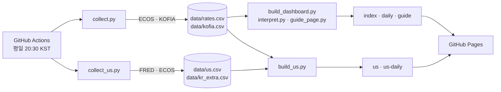

# Rates & Spreads Dashboard

한국·미국 금리 및 크레딧 스프레드 일별 자동 수집, 규칙 기반 해석 대시보드.
GitHub Actions로 매 영업일 데이터를 수집하고 GitHub Pages로 배포.

## 페이지

| 페이지 | 내용 |
|---|---|
| [한국 대시보드](https://dlrjsdndlsepdy.github.io/rate-dashboard/) | 공통 · 캐피탈 · 기업금융 · 보험 · 은행 · 위험자산 탭 |
| [한국 오늘의 해석](https://dlrjsdndlsepdy.github.io/rate-dashboard/daily.html) | 규칙 R1~R15 기반 일일 해석, 최근 20영업일 기록 |
| [미국 대시보드](https://dlrjsdndlsepdy.github.io/rate-dashboard/us.html) | 커브 · 정책·단기 · 크레딧 · 물가·실질 · 위험자산 · 한미 비교 탭 |
| [미국 오늘의 해석](https://dlrjsdndlsepdy.github.io/rate-dashboard/us-daily.html) | 규칙 U1~U14 기반 일일 해석, 한미 연결 |
| [지표 가이드](https://dlrjsdndlsepdy.github.io/rate-dashboard/guide.html) | 지표별 정의 · 의미 · 해석 방법 · 출처 |

## 지표

각 지표별 현재값, 전일 대비 변화(bp), 1년 중 위치(0 = 1년 최저, 100 = 1년 최고), 기간별 추이 차트 제공.

| 탭 | 지표 |
|---|---|
| 공통 | 국고채 3·10년, 회사채 AA− 3년, 장단기 스프레드(10Y−3Y), 회사채 크레딧 스프레드 |
| 캐피탈 | 여전채 AA−·A+ 3년, 여전채 크레딧 스프레드, 등급 스프레드(A+−AA−), CP·CD 91일, CP−CD |
| 기업금융 | 회사채 AA−·A−·BBB+ 3년(민평), A− 크레딧 스프레드, 등급 스프레드(A−−AA−, BBB+−AA−) |
| 보험 | 국고채 10·30년, 초장기 스프레드(30Y−10Y), 장단기 스프레드 |
| 은행 | CD·CP 91일, CP−CD, 국고채 3년 |
| 위험자산 | 코스피, 코스닥, 회사채·여전채·A− 크레딧 스프레드 |
| 미국 커브 | 미 국채 3M·2Y·10Y·30Y, 2s10s, 10Y−3M |
| 미국 정책·단기 | 연준 기준금리 상·하단, 실효 연방기금금리, SOFR, 정책 기대 갭(2Y − 기준금리 중간값) |
| 미국 크레딧 | ICE BofA 투자등급·하이일드 OAS, HY−IG |
| 미국 물가·실질 | 10년 TIPS 실질금리, 10년 기대인플레이션(BEI = 명목 − TIPS) |
| 미국 위험자산 | S&P 500, VIX, 하이일드·투자등급 스프레드 |
| 한미 비교 | 한미 10년 금리차, 한미 기준금리차, 환헤지 비용 근사(미 3M − CD 91일), 원/달러 |

## 해석 로직

**판정 기준**

| 항목 | 기준 |
|---|---|
| 보합 | 전일 대비 ±1bp 미만 (미국 회사채 스프레드·환율 ±2) |
| 이례적 변동 | 전일 대비 변화 > 최근 1년 일간 변화 표준편차 × 2 |
| 고점권 / 저점권 | 1년 중 위치 ≥ 90 / ≤ 10 |
| 추세 | 최근 5영업일 누적 변화와 당일 방향 비교 (지속 / 되돌림) |

**한국 규칙 (R1~R15)**

| 규칙 | 조건 | 해석 |
|---|---|---|
| R1~R5 | 국고 3Y·10Y 변화 방향과 크기 | 불·베어 × 스티프닝·플래트닝, 트위스트 |
| R6·R7 | 회사채·여전채·A− 크레딧 스프레드 확대·축소 | 신용위험 회피·선호 |
| R8·R9 | 국고 금리와 회사채 스프레드 반대 방향 (5일 흐름으로 확인) | Risk-off·Risk-on |
| R10 | 등급 스프레드 확대 | 신용 차별화 심화 |
| R11 | CP−CD 확대 (여전채 스프레드 보합 시 별도 표시) | 단기 자금시장 스트레스 |
| R12 | CD 상승폭 > 국고 3년 상승폭 | 단기 금리 상승 압력 |
| R13 | 30Y−10Y 축소·역전 | 초장기물 수요 강세 |
| R14 | 코스피와 회사채 스프레드 반대 방향 | 주식·크레딧 동반 위험 회피·선호 |
| R15 | 5일간 코스피↑·스프레드↑ / 코스피 급락·스프레드 안정 | 크레딧 선행 경고 / 주식 단독 조정 |

**미국 규칙 (U1~U14)**

| 규칙 | 조건 | 해석 |
|---|---|---|
| U1~U5 | 미 국채 2Y·10Y 변화 방향과 크기 | 커브 국면 |
| U6 | 10년 변화 = 실질금리 변화 + 기대인플레 변화 | 금리 변동 주도 요인 |
| U7 | 정책 기대 갭 변화·수준 (−25bp ≈ 인하 1회 근사) | 연준 인하·인상 기대 |
| U8·U9 | 미 국채 금리와 HY 스프레드 반대 방향, HY−IG 확대 | 글로벌 Risk-off·on, 등급 차별화 |
| U10 | 2s10s·10Y−3M 신규 역전·지속·해소 | 커브 역전 상태 |
| U11 | 한미 10년 금리차 변화 | 외국인 채권 수급·환율 요인 |
| U12 | 미 10년 2σ 변동 다음 날 한국 10년 반응, 120일 회귀 계수 β | 한미 금리 동조화 |
| U13 | VIX·HY 스프레드 동반 상승, VIX 20·30 구간 | Risk-off 확인, 변동성 국면 |
| U14 | 5일간 S&P 500↑·HY↑ / S&P 500 급락·HY 안정 | 크레딧 선행 경고 / 주식 단독 조정 |

## 방법론

- **산출 기준 통일**: 최종호가수익률(ECOS)과 시가평가기준수익률(KOFIA 민평)을 혼용하지 않음. 민평 지표의 스프레드는 민평 국고채 3년 대비로 산출.
- **회사채 반영 지연 보정**: 국고·회사채 스프레드 기반 Risk-off·on 판정은 5영업일 흐름으로 재확인.
- **지표별 변동성 기준**: 이례적 변동은 고정 문턱값 대신 지표별 1년 일간 변화 표준편차로 판정.
- **한미 날짜 정렬**: 한국 날짜 t에 미국 날짜 ≤ t−1인 최신 공표값 매칭. FRED 공표 지연(1~2영업일)으로 실제 사용된 미국 날짜 병기.
- **증분 수집**: KOFIA는 신규 날짜만 조회해 `data/kofia.csv`에 누적. 수집 항목 변경 시 스키마 버전으로 재수집.
- **장애 격리**: 미국 수집·생성 단계 실패 시에도 한국 페이지는 정상 갱신.

## 데이터 출처

| 출처 | 항목 |
|---|---|
| 한국은행 ECOS — 시장금리(일별, 817Y002) | 국고채 3·10·30년, 회사채 AA− 3년, CD·CP 91일 |
| 한국은행 ECOS — 722Y001, 731Y001, 802Y001 | 한국은행 기준금리, 원/미국달러 매매기준율, 코스피·코스닥 |
| 금융투자협회 KOFIA — 채권시가평가기준수익률(평가사 평균) | 국고채, 금융채 II(여전채) AA−·A+, 회사채 I(공모) AA−·A−·BBB+ — 잔존 3년 |
| FRED | DGS3MO, DGS2, DGS10, DGS30, DFEDTARU, DFEDTARL, DFF, SOFR, DFII10, BAMLC0A0CM, BAMLH0A0HYM2, SP500, VIXCLS |

## 구조

| 파일 | 역할 |
|---|---|
| `collect.py` | ECOS·KOFIA 수집, 스프레드 산출 → `data/rates.csv`, `data/kofia.csv` |
| `collect_us.py` | FRED 수집, ECOS 기준금리·환율 수집 → `data/us.csv`, `data/kr_extra.csv` |
| `build_dashboard.py` | 한국 대시보드 생성, 해석·가이드 페이지 생성 호출 |
| `interpret.py` | 한국 해석 엔진 (R1~R15) |
| `build_us.py` | 미국 대시보드 및 해석 엔진 (U1~U14) |
| `minichart.py` | 해석 페이지 그래프 |
| `pwa.py` | 설치형 웹앱(PWA) 설정 |
| `guide_page.py` | 지표 가이드 |
| `.github/workflows/update.yml` | 실행 스케줄 (평일 UTC 11:30) |

**스택**: Python (pandas, requests), Chart.js, GitHub Actions, GitHub Pages

**필요 Secrets**: `ECOS_API_KEY`, `FRED_API_KEY`

## 한계

- 규칙 기반 해석은 대표적 해석만 제시. 원인(통화정책 회의, 경제지표, 수급)은 별도 확인 필요.
- 민평 등급 스프레드는 평가사 조정 특성상 변동폭이 작음.
- 환헤지 비용은 단기 금리차 근사치로, 실제 스왑포인트와 차이 존재.

---

*학습용 프로젝트. 투자 권유 아님.*
